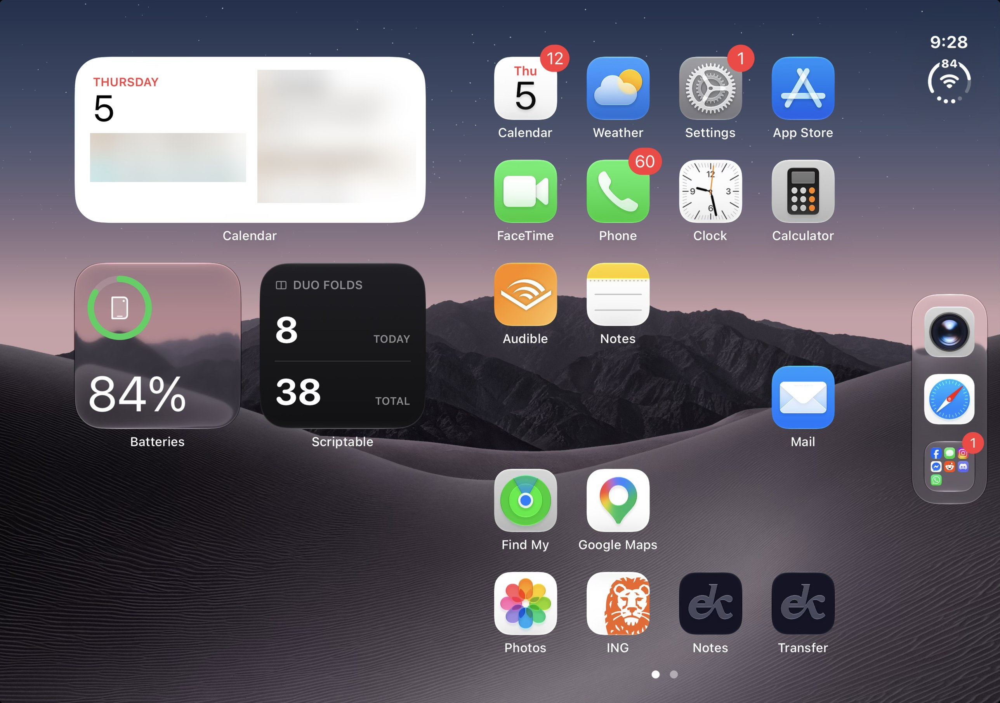

# Duo Folds: setup guide

Counts how many times you unfold your iPhone Duo, with a small home-screen widget.

Two Scriptable scripts:

| Script | What it does |
|---|---|
| **DuoLog** | Run by two Shortcuts automations. It writes a timestamped entry to `Scriptable/DuoFolds/duo-log.json` each time the phone is unfolded (`open`) or folded (`close`). It shows no UI. |
| **DuoFolds** | A small dark home-screen widget showing **TODAY** (unfolds since midnight) and **TOTAL** (every unfold logged). |

> The script names must be exactly `DuoLog` and `DuoFolds` (no `.js`). The Shortcuts action and the widget look them up by name.

---

## 1. Put the scripts on your phone

Do this for each file:

1. Open the `.js` file on your computer and copy everything in it.
2. Get it to your iPhone (AirDrop it, use Universal Clipboard, or email it to yourself).
3. In **Scriptable**, tap **+** (top right) to create a new script.
4. Paste the code.
5. Tap the title at the top (it says *Untitled Script*) and rename it `DuoLog` (or `DuoFolds` for the second file).
6. Tap **Done**.

*Shortcut if you use iCloud Drive:* copy both `.js` files into **iCloud Drive › Scriptable**. They show up in the app with the right names.

## 2. Check the logger

1. In Scriptable, tap **DuoLog**. With no parameter, it opens a menu.
2. Tap **Log OPEN (test)**, then **Log CLOSE (test)**. The stats at the top should show 1 unfold.
3. Tap **Delete last session** to remove that test entry.
4. *(Optional)* **Set starting total…**: if you know roughly how many times you'd unfolded the phone before installing this, enter it here. It gets added to TOTAL.

## 3. Automation: "When my iPhone is opened"

1. Open **Shortcuts** and go to the **Automation** tab.
2. Tap **+** (or **New Automation**).
3. Choose **Display**.
4. Select **Is Opened** and leave **Is Closed** unticked.
5. Choose **Run Immediately**, and turn **Notify When Run** off.
6. Tap **Next**, then **New Blank Automation**.
7. Tap **Add Action**, search for **Scriptable**, and choose **Run Script**.
8. Tap the **Script** placeholder and pick **DuoLog**.
9. Expand the action with the **⌄** button next to **Run DuoLog with Parameter**. Leave **Parameter** empty: on current iOS, tapping it opens a file picker.
   - Under **Texts**, tap **Add New Item** and type `open`.
   - Check that **Run In App** and **Show When Run** are both **off**. **Run In App** off is what makes it run headless.
   - *Alternative:* add a **Text** action containing `open` above Run Script, then tap **Parameter** and choose the **Text** variable from the variable bar above the keyboard.
10. Tap **Done**.

## 4. Automation: "When my iPhone is closed"

Repeat step 3 with two changes:

- In step 4, select **Is Closed** only.
- In step 9, type `close` under **Texts** instead of `open`.

> Use two separate automations. Don't use one automation with both boxes ticked, because the script has no way to tell which event fired it.

## 5. Test the automations

1. Fold and unfold the phone a few times, waiting a couple of seconds each time.
2. Open Scriptable and run **DuoLog**. TODAY should go up by one per unfold, and "Missed open/close events" should be 0.
3. If you get a red Shortcuts error banner, the parameter is probably misspelled. The banner message tells you what it received.

## 6. Add the widget

1. Long-press an empty spot on the home screen and tap **Edit › Add Widget**.
2. Search for **Scriptable**, choose the **small** size, and tap **Add Widget**.
3. While the icons are still jiggling, tap the new widget (or long-press it › **Edit Widget**).
   - **Script**: **DuoFolds**
   - **When Interacting**: **Run Script** (a tap opens Scriptable and shows the up-to-the-second numbers)
   - Leave **Parameter** empty.
4. Tap outside the panel, then tap **Done**.

---

## Good to know

- **Widget refresh delay.** iOS decides when widgets refresh, usually every few minutes, and sometimes longer. The script asks for a refresh every 5 minutes. The *log* is always written immediately; only the widget display can lag. Tapping the widget opens Scriptable with the current numbers. The home-screen widget itself often catches up when you return, but iOS does not guarantee it.
- **Missed events.** iOS sometimes skips an automation, for example during a low-power state or a reboot.
  - **Unfold with no fold logged:** when the next unfold arrives, the earlier entry is marked `noclose`. It still counts as an unfold but is left out of time totals.
  - **Fold with no unfold logged:** it's recorded as `noopen`. It counts as an unfold (you can't fold without unfolding first) but has no duration.
  - **Duplicates:** the same event arriving twice within 3 seconds is ignored.
- **Unfolded time.** Every entry has open and close timestamps. Run **DuoLog** in the app to see today's unfolded time, the average per unfold, and the all-time total. The widget only shows the two counts.
- **Where the data lives.** The log is stored on the device in Scriptable's local Documents folder: `DuoFolds/duo-log.json`, plus `duo-log.bak.json` as a crash-safe copy. Deleting Scriptable deletes it. If you'd rather keep it in iCloud Drive, set `USE_ICLOUD = true` at the top of **both** scripts. They must match. iCloud is slightly slower and needs a sync.
- **File size.** About 40 bytes per unfold, so 20 unfolds a day is roughly 300 KB a year. That's fine for years of use.
